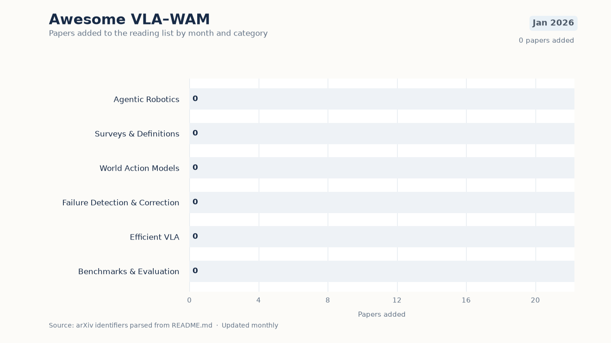

<h1 align="center">Awesome VLA–WAM</h1>

  <strong>Vision-Language-Action · World Action Models · Agentic Robotics</strong> 
  A curated, quality-gated reading list for embodied intelligence.

  
  
  

  <a href="#contents">Explore the papers</a> &nbsp; · &nbsp;
  <a href="#surveys-and-definitions">Start with surveys</a> &nbsp; · &nbsp;
  <a href="#contributing">Contribute</a>

  

## Contents

<table>
  <tr>
    <td width="50%" valign="top">
       
      

      <h3>01 · Agentic Robotics</h3>
      
Long-horizon embodied agents, planning, memory, tools, and skill orchestration.

      
<a href="#agentic-robotics-new-trend"><strong>Explore papers →</strong></a> &nbsp; · &nbsp; <a href="AGENTIC_ROBOTICS.md">Full archive</a>

    </td>
    <td width="50%" valign="top">
       
      

      <h3>02 · World Action Models</h3>
      
Video foresight, vision-language models, and predictive latent dynamics.

      
<a href="#world-action-models"><strong>Explore papers →</strong></a> &nbsp; · &nbsp; <a href="WORLD_ACTION_MODELS.md">Full archive</a>

    </td>
  </tr>
  <tr>
    <td width="50%" valign="top">
       
      

      <h3>03 · Failure Detection &amp; Correction</h3>
      
Feedback, verification, recovery, and online adaptation for reliable VLA systems.

      
<a href="#vla-failure-detection-and-correction"><strong>Explore papers →</strong></a> &nbsp; · &nbsp; <a href="VLA_FAILURE_DETECTION_AND_CORRECTION.md">Full archive</a>

    </td>
    <td width="50%" valign="top">
       
      

      <h3>04 · Efficient VLA</h3>
      
Compression, adaptation, action tokenization, and efficient deployment.

      
<a href="#efficient-vla"><strong>Explore papers →</strong></a> &nbsp; · &nbsp; <a href="EFFICIENT_VLA.md">Full archive</a>

    </td>
  </tr>
</table>

  <strong>Reference shelf</strong> &nbsp; · &nbsp;
  <a href="#surveys-and-definitions">Surveys &amp; Definitions</a> &nbsp; · &nbsp;
  <a href="#benchmarks-for-robustness-and-evaluation">Benchmarks &amp; Evaluation</a>

> **Reading guide** · Core lists keep the **10 newest qualifying papers**; linked archives retain the longer history. Reference sections may be shorter. 
> **Relevance** · ⭐⭐⭐ direct fit &nbsp; · &nbsp; ⭐⭐ adjacent/supporting &nbsp; · &nbsp; ⭐ background/context.

<strong>Curation policy &amp; scope</strong>

> **Core lists:** Every primary paper table or subsection in this README keeps
> exactly the 10 newest qualifying papers, ordered by available arXiv date or
> identifier. The linked archive documents retain the longer historical lists.
>
> **Reference lists:** Surveys and Definitions, and Benchmarks for Robustness
> and Evaluation, are compact reference sections and may contain fewer than 10
> entries when fewer items are retained.
>
> **Relevance:** ⭐⭐⭐ direct fit · ⭐⭐ adjacent/supporting · ⭐ background/context.

The agentic robotics section requires an explicit embodied-agent layer that
coordinates multi-step physical execution through high-level planning, memory,
tool or skill discovery and composition, VLA/VLM or policy orchestration,
recovery, or online policy self-improvement. Pure navigation or VLN policies
without another agentic robotics capability are out of scope. Standalone prompt
optimization, generic exploration, or low-level VLA improvements without this
agent-level role are also out of scope.
The failure detection/correction section is not a one-to-one heading in the source
repository; it groups papers that are closely related through environment
feedback, self-improvement, verification, closed-loop learning, preference
alignment, online planning, or robustness evaluation.

<strong>Research activity · Monthly paper counts</strong>

  

The animation tracks papers added since January 2026. It is regenerated from
the arXiv identifiers in this README with
[`scripts/generate_monthly_paper_chart.py`](scripts/generate_monthly_paper_chart.py).

---

## Agentic Robotics (New Trend)

[Browse the full archive →](AGENTIC_ROBOTICS.md)

This emerging line treats robot foundation models as components inside a
broader embodied-agent loop. Papers belong here only when the agent layer is
central to coordinating physical multi-step execution through planning,
memory, tool or skill composition, policy orchestration, recovery, or online
self-improvement; pure navigation-only or VLN policies are out of scope.

| Paper | Title | Links | Relevance |
| :--- | :--- | :--- | :---: |
| **FineDex** | FineDex: Bridging Fine-Grained Human-Object Interaction Generation to Dexterous Humanoid Manipulation. | [arXiv](https://arxiv.org/abs/2611.34884) · [Project](https://finedex.github.io/) · [Code](https://github.com/zyjOrz/FineDex) | ⭐⭐⭐ |
| **PyRUA-Dex** | PyRUA-Dex: Learning Programmatic Policies for Dexterous Bimanual Manipulation with Coding Agents. | [arXiv](https://arxiv.org/abs/2611.33144) · [Project](https://vme0522.github.io/PyRUA-Dex/) · [Code](https://github.com/DAGroup-PKU/PyRUA-Lean/tree/dex) | ⭐⭐⭐ |
| **ACAP** | ACAP: Asynchronous Coding Agents for Efficient Robot Control. | [arXiv](https://arxiv.org/abs/2611.31205) · [Project](https://projects.zxhezexin.com/acap/) | ⭐⭐⭐ |
| **EvoTER** | EvoTER: Evolving Embodied Agents via Tool-Use Experience and Reflection. | [arXiv](https://arxiv.org/abs/2611.27797) · [Project](https://evoter-project.github.io/) | ⭐⭐⭐ |
| **PGX** | PGX: Physically Grounded Execution for Long-Horizon Humanoid Loco-Manipulation. | [arXiv](https://arxiv.org/abs/2611.26596) · [Project](https://kl-research.github.io/pgx) | ⭐⭐⭐ |
| **F³** | F³: What Makes Good Experience in World-Action Models? | [arXiv](https://arxiv.org/abs/2611.24708) | ⭐⭐⭐ |
| **InteractVLA** | InteractVLA: Turning VLAs into Interactive Tools for Agentic Robotic Manipulation. | [arXiv](https://arxiv.org/abs/2611.22584) · [Project](https://lingwupro.github.io/InteractVLA/) · [Code](https://github.com/LingwuPro/InteractVLA) | ⭐⭐⭐ |
| **Lazy-MOSAIC** | Lazy-MOSAIC: Accelerating Skill-Centric Manipulation Planning with Learned Skill-Effect World Models. | [arXiv](https://arxiv.org/abs/2611.21517) · [Project](https://skill-mosaic.github.io) | ⭐⭐⭐ |
| **PEAR** | Training Reasoning Models in Simulation to Natively Use Real Robots. | [arXiv](https://arxiv.org/abs/2611.18562) · [Code](https://github.com/mit-han-lab/pear) | ⭐⭐⭐ |
| **NSDL** | NSDL: Neuro-Symbolic Division of Labor for Multi-Robot Task Planning. | [arXiv](https://arxiv.org/abs/2611.16671) · [Code](https://github.com/Xincheng-Tan/NSDL) | ⭐⭐⭐ |

<a href="#contents">↑ Back to contents</a>

---

## Surveys and Definitions

| Paper | Title | Links | Relevance |
| :--- | :--- | :--- | :---: |
| **Embodied Brains Roadmap** | From World Action Models to Embodied Brains: A Roadmap for Open-World Physical Intelligence. | [arXiv](https://arxiv.org/abs/2607.11689) | ⭐⭐⭐ |
| **VLA Review: UAV and Bimanual** | Vision Language Action (VLA) Models for Unmanned Aerial Robotics and Bimanual Manipulation: A Review. | [arXiv](https://arxiv.org/abs/2607.06706) | ⭐⭐⭐ |
| **World Action Models Tutorial** | From World Models to World Action Models: A Concise Tutorial for Robotics. | [arXiv](https://arxiv.org/abs/2607.00836) · [Website](https://clearlab-sustech.github.io/WorldModelSurvey/) · [Code](https://github.com/clearlab-sustech/WorldModelSurvey) | ⭐⭐⭐ |
| **World Model for Robot Learning** | World Model for Robot Learning: A Comprehensive Survey. | [arXiv](https://arxiv.org/abs/2605.00080) · [Website](https://ntumars.github.io/wm-robot-survey/) · [Code](https://github.com/NTUMARS/Awesome-World-Model-for-Robotics-Policy) | ⭐⭐⭐ |
| **Embodied Agentic AI** | Towards Embodied Agentic AI: Review and Classification of LLM- and VLM-Driven Robot Autonomy and Interaction. | [arXiv](https://arxiv.org/abs/2508.05294) | ⭐⭐⭐ |

<a href="#contents">↑ Back to contents</a>

---

## World Action Models

[Browse the full archive →](WORLD_ACTION_MODELS.md)

**Jump to:** [Robustness & Security](#robustness-and-security) · [Video Generation](#video-generation-based-wam) · [VLM-Based](#vlm-based-wam) · [Efficient Inference](#efficient-inference-for-wams) · [Latent Dynamics](#wam-from-scratch-and-latent-dynamics)

### Robustness and Security

| Paper | Title | Links | Relevance |
| :--- | :--- | :--- | :---: |
| **HOG-WAM** | HOG-WAM: Improving Visual Robustness through Future Gradient Prediction. | [arXiv](https://arxiv.org/abs/2611.34811) · [Code](https://github.com/iPPLab/HOG-WAM) | ⭐⭐⭐ |
| **SteerTrace** | SteerTrace: Tracing How Target Attacks Steer World Action Models. | [arXiv](https://arxiv.org/abs/2611.25719) | ⭐⭐⭐ |
| **PICA-WAM** | PICA-WAM: Visual Perturbation Invariance via Cross-Appearance Self-Alignment in World Action Models. | [arXiv](https://arxiv.org/abs/2610.26813) · [Code](https://github.com/YudeZou/PICA-WAM-release) | ⭐⭐⭐ |
| **TAPDreamer** | TAPDreamer: Transferable Adversarial Patches for World Action Models. | [arXiv](https://arxiv.org/abs/2610.06814) · [Project](https://tapdreamer.github.io/) | ⭐⭐⭐ |

### Video-Generation-Based WAM

| Paper | Title | Links | Relevance |
| :--- | :--- | :--- | :---: |
| **WVP** | Wrist-Camera Video Diffusion as Generalizable Robot Policies. | [arXiv](https://arxiv.org/abs/2611.31079) · [Project](https://wrist-video-policy.github.io/) | ⭐⭐⭐ |
| **Ego4Gen** | Ego4Gen: Generating Geometry-Grounded Motion Tokens as a World-Action Interface. | [arXiv](https://arxiv.org/abs/2611.27513) | ⭐⭐⭐ |
| **FLUX-mimic** | Video-Action Models for Data-Efficient Industrial Manipulation. | [arXiv](https://arxiv.org/abs/2611.15974) | ⭐⭐⭐ |
| **Rolling-WAM** | Rolling-WAM: World Action Models with Rolling Imagination. | [arXiv](https://arxiv.org/abs/2609.30247) · [Project](https://rolling-wam.github.io/) | ⭐⭐⭐ |
| **CLAP** | CLAP: Cross-Embodiment Video World Models are Zero-Shot Physical Simulators. | [arXiv](https://arxiv.org/abs/2608.27406) · [Project](https://omni-clap.github.io/) | ⭐⭐⭐ |
| **TacPAC** | TacPAC: Tactile Prediction and Real-Time Action Correction in World-Action Models for Contact-Rich Manipulation. | [arXiv](https://arxiv.org/abs/2609.05266) · [Code](https://github.com/LogosRoboticsGroup/TacPAC) | ⭐⭐⭐ |
| **SV-WAM** | SV-WAM: An Efficient Surround-View World-Action Model for End-to-End Autonomous Driving. | [arXiv](https://arxiv.org/abs/2609.03602) | ⭐⭐⭐ |
| **SA-WAM** | Spatially Aware World Action Model via Geometric Latent Diffusion. | [arXiv](https://arxiv.org/abs/2609.02531) | ⭐⭐⭐ |
| **IMPACT** | IMPACT: Attention Is the Interaction Map for Scalable Interaction-Aware World Model Training. | [arXiv](https://arxiv.org/abs/2609.00161) | ⭐⭐⭐ |
| **AcrossVAM1.0** | AcrossVAM1.0: Particle World Modeling for Text-Assisted Robot Video Prediction. | [arXiv](https://arxiv.org/abs/2608.28491) | ⭐⭐⭐ |

### VLM-Based WAM

| Paper | Title | Links | Relevance |
| :--- | :--- | :--- | :---: |
| **AgentWorld** | Learning Agent-Centric Vision-Language-Action World Models for Autonomous Driving. | [arXiv](https://arxiv.org/abs/2611.22880) · [Project](https://AgentWorld-AD.github.io) | ⭐⭐⭐ |
| **ForeTime-VLA** | ForeTime-VLA: Causal Future-Token Distillation from a World Action Model for Conveyor-Belt Manipulation. | [arXiv](https://arxiv.org/abs/2608.20735) | ⭐⭐⭐ |
| **HyWorldVLA** | HyWorldVLA: A Vision-Language-Action Model with Hybrid World Modeling for Autonomous Driving. | [arXiv](https://arxiv.org/abs/2607.20988) | ⭐⭐⭐ |
| **DSWAM** | DSWAM: A Dual-System World Action Foundation Model for Fine-Grained Robot Manipulation. | [arXiv](https://arxiv.org/abs/2607.04927) | ⭐⭐⭐ |
| **FutureNav** | FutureNav: Unified World-Action Modeling for Vision-and-Language Navigation. | [arXiv](https://arxiv.org/abs/2606.30367) | ⭐⭐⭐ |
| **WLA** | World-Language-Action Model for Unified World Modeling, Language Reasoning, and Action Synthesis. | [arXiv](https://arxiv.org/abs/2606.05979) · [Website](https://github.com/SJTU-DENG-Lab/WLA) | ⭐⭐⭐ |
| **CKT-WAM** | CKT-WAM: Parameter-Efficient Context Knowledge Transfer Between World Action Models. | [arXiv](https://arxiv.org/abs/2605.06247) · [Website](https://github.com/YuhuaJiang2002/CKT-WAM) | ⭐⭐ |
| **World-Value-Action Model** | World-Value-Action Model: Implicit Planning for Vision-Language-Action Systems. | [arXiv](https://arxiv.org/abs/2604.14732) | ⭐⭐⭐ |
| **WoG** | World Guidance World Modeling in Condition Space for Action Generation. | [arXiv](https://arxiv.org/abs/2602.22010) · [Website](https://selen-suyue.github.io/WoGNet/) | ⭐⭐ |
| **VLAW** | VLAW: Iterative Co-Improvement of Vision-Language-Action Policy and World Model. | [arXiv](https://arxiv.org/abs/2602.12063) · [Website](https://sites.google.com/view/vlaw-arxiv) | ⭐⭐⭐ |

### Efficient Inference for WAMs

| Paper | Title | Links | Relevance |
| :--- | :--- | :--- | :---: |
| **iWAM** | iWAM: Efficient Action Prediction from World Models without Explicit Future Prediction. | [arXiv](https://arxiv.org/abs/2611.33141) | ⭐⭐⭐ |
| **LAQ** | Don't Lose the Future: Latent-Aware 4-Bit Quantization of World Action Models. | [arXiv](https://arxiv.org/abs/2611.25614) | ⭐⭐⭐ |
| **CF-Prune** | Complementary Future Token Pruning for World Action Models. | [arXiv](https://arxiv.org/abs/2610.19957) | ⭐⭐⭐ |

### WAM from Scratch and Latent Dynamics

| Paper | Title | Links | Relevance |
| :--- | :--- | :--- | :---: |
| **Z-sight** | Z-sight: Unifying Vision-Language-Action and Latent World Modeling. | [arXiv](https://arxiv.org/abs/2611.24940) · [Project](https://junjieye.com/Z-sight/) | ⭐⭐⭐ |
| **ThinkWAM** | ThinkWAM: Rethinking Latent Futures for Action Refinement. | [arXiv](https://arxiv.org/abs/2611.21258) · [Project](https://thinkwam-project.github.io/) · [Code](https://github.com/HaoyunT/Thinkwam) | ⭐⭐⭐ |
| **WATO** | Joint World Action Models through Differentiable Trajectory Optimization. | [arXiv](https://arxiv.org/abs/2611.17626) | ⭐⭐⭐ |
| **MetaWAM** | From Video Frames to Robot Meta-Frames: A Unified Latent Interface for World Action Models. | [arXiv](https://arxiv.org/abs/2611.14365) · [Code](https://github.com/showlab/MetaWAM) | ⭐⭐⭐ |
| **SWAM** | SWAM: Scaling World Action Models with Cross-Modal Alignment. | [arXiv](https://arxiv.org/abs/2611.12870) · [Project](https://char-lotte-xia.github.io/swam-official/) · [Code](https://github.com/shaaaaron/SWAM) | ⭐⭐⭐ |
| **MDF++** | MDF++: Visuo-Tactile World Action Model with End-to-end Representation Learning. | [arXiv](https://arxiv.org/abs/2611.09293) · [Project](https://jointmdf.github.io/) | ⭐⭐⭐ |
| **GPWM** | GPWM: Modeling the World as 3D Particle Motion. | [arXiv](https://arxiv.org/abs/2611.08338) · [Project](https://robertren1122.github.io/gpwm/) | ⭐⭐⭐ |
| **La-JEPA** | La-JEPA: Compact Robot Policies with Latent World Modeling. | [arXiv](https://arxiv.org/abs/2611.08156) · [Code](https://github.com/mt-clemente/lajepa) | ⭐⭐⭐ |
| **OSWAM** | OSWAM: An Effective World Action Model with One-Step Action Generation. | [arXiv](https://arxiv.org/abs/2610.35850) · [Project](https://gwenzhang.github.io/OSWAM/) | ⭐⭐⭐ |
| **UniFlowWAM** | UniFlowWAM: A Unified World-Action Model with Visual Semantics and 4D Geometry. | [arXiv](https://arxiv.org/abs/2610.30991) | ⭐⭐⭐ |

<a href="#contents">↑ Back to contents</a>

---

## VLA Failure Detection and Correction

[Browse the full archive →](VLA_FAILURE_DETECTION_AND_CORRECTION.md)

These papers are useful entry points for failure-aware VLA systems, especially
when the method uses feedback, online adaptation, closed-loop correction,
self-evaluation, or policy/world-model co-improvement.

| Paper | Title | Links | Relevance |
| :--- | :--- | :--- | :---: |
| **Cairn** | Cairn: Object-Centric 3D Trajectory Priors for Steering Frozen VLAs. | [arXiv](https://arxiv.org/abs/2611.34914) | ⭐⭐⭐ |
| **β-Data** | Exploratory Midtraining for Robot Policies. | [arXiv](https://arxiv.org/abs/2611.33130) · [Project](https://kshitiz-1225.github.io/exploratory-midtraining-robot-policies/) | ⭐⭐⭐ |
| **EmboEagle** | EmboEagle: An Efficient Agentic Embodied Framework for Long-horizon Robotic Manipulation. | [arXiv](https://arxiv.org/abs/2611.31173) · [Code](https://github.com/Markus-xu/EmboEagle) | ⭐⭐⭐ |
| **GAC** | Generalist Action Critic: Harnessing Frontier Models in Autonomous Driving. | [arXiv](https://arxiv.org/abs/2611.27804) · [Project](https://yanyunn.github.io/GAC/) | ⭐⭐⭐ |
| **R2-VLA** | Risk-Controlled Test-Time Adaptation for Vision-Language-Action Models. | [arXiv](https://arxiv.org/abs/2611.26438) | ⭐⭐⭐ |
| **RECLAIM** | RECLAIM: Robot-Vision-Informed Adversarial Patch Defense via Embodied Attention Feedback. | [arXiv](https://arxiv.org/abs/2611.24494) | ⭐⭐⭐ |
| **Fly as Instructed** | Fly as Instructed: Refining World-Action Policies for UAV Vision-Language Navigation. | [arXiv](https://arxiv.org/abs/2611.22883) | ⭐⭐⭐ |
| **FAVR** | FAVR: Flow-Aware Visual Residual Alignment for Vision-Language-Action Policies. | [arXiv](https://arxiv.org/abs/2611.20971) | ⭐⭐⭐ |
| **ESI** | ESI: An Embodied Self-Improvement Flywheel for LLM-VLA Agents. | [arXiv](https://arxiv.org/abs/2611.18176) | ⭐⭐⭐ |
| **MOSAIC** | MOSAIC: Modular Obstacle and Spatial-Aware Framework for Manipulation In Cluttered Scenes. | [arXiv](https://arxiv.org/abs/2611.15937) · [Project](https://mmahdavian.github.io/MOSAIC/) | ⭐⭐⭐ |

<a href="#contents">↑ Back to contents</a>

---

## Efficient VLA

[Browse the full archive →](EFFICIENT_VLA.md)

**Jump to:** [Compression & Adaptation](#compression-adaptation-and-model-merging) · [Tokenization & Deployment](#tokenization-fine-tuning-and-deployment-friendly-vlas)

### Compression, Adaptation, and Model Merging

| Paper | Title | Links | Relevance |
| :--- | :--- | :--- | :---: |
| **TauPrune-VLA** | Perception Is Enough, at the Right Scale: Scale-Adaptive Token Pruning for Vision-Language-Action Models. | [arXiv](https://arxiv.org/abs/2611.31954) · [Project](https://lin0e0.github.io/TauPrune-VLA/) | ⭐⭐⭐ |
| **MoOP** | Pruning Autonomous Driving VLAs: What to Preserve for Reasoning and Action. | [arXiv](https://arxiv.org/abs/2611.31240) · [Project](https://cvlab-kaist.github.io/MoOP/) · [Code](https://github.com/cvlab-kaist/MoOP) | ⭐⭐⭐ |
| **POKE** | POKE: Probe Offline, Keep Efficiently for Vision-Language-Action Models. | [arXiv](https://arxiv.org/abs/2611.21033) | ⭐⭐⭐ |
| **Be My Eye** | Be My Eye: Learning to See Beyond a Robot's Own Perspective. | [arXiv](https://arxiv.org/abs/2611.12295) | ⭐⭐⭐ |
| **T3R** | T3R: Training-Free Two-Stage Token Refinement Towards Efficient and Robust VLA Models. | [arXiv](https://arxiv.org/abs/2611.08413) · [Project](https://midotronn.github.io/t3r/) · [Code](https://github.com/midotronn/t3r) | ⭐⭐⭐ |
| **QbD-VLA** | Quantize by Doing: Task-Guided Mixed-Precision Quantization of Vision-Language-Action Models. | [arXiv](https://arxiv.org/abs/2610.38661) · [Code](https://github.com/jiuyixu25/QbD-VLA) | ⭐⭐⭐ |
| **JevVLA** | JevVLA: Jev-Inspired Energy-Based Adaptation for Vision-Language-Action Policies. | [arXiv](https://arxiv.org/abs/2610.35010) · [Code](https://github.com/ZJU4EmbodiedAI/JevVLA) | ⭐⭐⭐ |
| **SPAR** | SPAR: Structural Pruning and Action Recovery for Vision-Language-Action Models. | [arXiv](https://arxiv.org/abs/2610.26487) | ⭐⭐⭐ |
| **MambaAct** | MambaAct: Efficient Mamba Action Experts for Flow-Matching Vision-Language-Action Models. | [arXiv](https://arxiv.org/abs/2610.22951) · [Code](https://github.com/giakhuyendihoc/MambaAct) | ⭐⭐⭐ |
| **REKI** | REKI: Registering Knowledge in VLAs. | [arXiv](https://arxiv.org/abs/2610.22178) · [Code](https://github.com/kyutai-labs/reki) | ⭐⭐⭐ |

### Tokenization, Fine-Tuning, and Deployment-Friendly VLAs

| Paper | Title | Links | Relevance |
| :--- | :--- | :--- | :---: |
| **RePace** | RePace: Reasoning about Demonstration Speedup for Faster Vision-Language-Action Policies. | [arXiv](https://arxiv.org/abs/2611.34864) | ⭐⭐⭐ |
| **LS-MBPO** | Efficient VLA Reinforcement Learning via Subchunk Rollouts in Latent World Models. | [arXiv](https://arxiv.org/abs/2611.27645) | ⭐⭐⭐ |
| **FastRoverVLA** | FastRoverVLA: Fast Vision-Language-Action Execution for Off-Road Autonomous Driving. | [arXiv](https://arxiv.org/abs/2611.26242) · [Project](https://adept-org.github.io/FastRoverVLA/) · [Code](https://github.com/ADEPT-ORG/FastRoverVLA) | ⭐⭐⭐ |
| **RoboMorpher** | RoboMorpher: Scaling Robot Morphology Representations for Cross-Embodiment Action Prediction. | [arXiv](https://arxiv.org/abs/2611.24816) · [Project](https://robomorpher.github.io/) | ⭐⭐⭐ |
| **VSpark** | VSpark: Speculative Decoding for Autoregressive Vision-Language-Action Models. | [arXiv](https://arxiv.org/abs/2611.22666) | ⭐⭐⭐ |
| **SALA** | SALA: Semantically Aligned Latent Actions Enable Dual-Axis Scaling of Embodied Foundation Models. | [arXiv](https://arxiv.org/abs/2611.17110) · [Project](https://sala-vla.github.io/) | ⭐⭐⭐ |
| **CIALLO** | CIALLO: Learning Shared Intent Representations for Cross-Embodiment Manipulation. | [arXiv](https://arxiv.org/abs/2611.13732) | ⭐⭐⭐ |
| **SURE** | SURE: Spatiotemporal Uncertainty Representation for Efficient Vision-Language-Action Learning. | [arXiv](https://arxiv.org/abs/2611.09684) | ⭐⭐⭐ |
| **JADE** | Vision-Language Models Are Joint Denoisers in Robotic Action Generation. | [arXiv](https://arxiv.org/abs/2611.01215) | ⭐⭐⭐ |
| **Coupling Execution Horizon and Sampling Depth** | Coupling Execution Horizon and Sampling Depth in Flow-Matching VLA Policies. | [arXiv](https://arxiv.org/abs/2610.32102) | ⭐⭐⭐ |

<a href="#contents">↑ Back to contents</a>

---

## Benchmarks for Robustness and Evaluation

| Paper | Title | Links | Relevance |
| :--- | :--- | :--- | :---: |
| **WorldArena** | WorldArena: A Unified Benchmark for Evaluating Perception and Functional Utility of Embodied World Models. | [arXiv](https://arxiv.org/abs/2602.08971) · [Website](https://world-arena.ai) | ⭐⭐ |
| **LIBERO-Plus** | LIBERO-Plus: In-depth Robustness Analysis of Vision-Language-Action Models. | [arXiv](https://arxiv.org/abs/2510.13626) · [Website](https://sylvestf.github.io/LIBERO-plus/) | ⭐⭐⭐ |
| **RoboArena** | RoboArena: Distributed Real-World Evaluation of Generalist Robot Policies. | [arXiv](https://arxiv.org/abs/2506.18123) · [Website](https://robo-arena.github.io) | ⭐ |
| **RoboTwin 2.0** | RoboTwin 2.0: A Scalable Data Generator and Benchmark with Strong Domain Randomization for Robust Bimanual Robotic Manipulation. | [arXiv](https://arxiv.org/abs/2506.18088) · [Website](https://github.com/robotwin-Platform/robotwin/) | ⭐⭐ |
| **SimplerEnv** | Evaluating Real-World Robot Manipulation Policies in Simulation. | [arXiv](https://arxiv.org/abs/2405.05941) · [Website](https://simpler-env.github.io) | ⭐ |
| **LIBERO** | LIBERO: Benchmarking Knowledge Transfer for Lifelong Robot Learning. | [arXiv](https://arxiv.org/abs/2306.03310) · [Website](https://libero-project.github.io/main.html) | ⭐ |

<a href="#contents">↑ Back to contents</a>

---

## Contributing

Pull requests are welcome. A good entry should include:

- Paper or project name.
- Full title.
- arXiv, paper, project, or code link.
- One suggested category.
- Optional note explaining why it belongs in that category.

For every curated update, keep the primary Codex author and add
`Co-authored-by: wangskyone <wangskyone@users.noreply.github.com>` to the
commit message.

<a href="#contents">↑ Back to contents</a>

---

## Acknowledgements

Initial paper entries were reorganized from
[DravenALG/awesome-vla-wam](https://github.com/DravenALG/awesome-vla-wam).

---

  <strong>Awesome VLA–WAM</strong> 
  A curated reading list for embodied intelligence.  
  <a href="#top">Back to top ↑</a> &nbsp; · &nbsp; <a href="#contents">Explore the papers</a>

